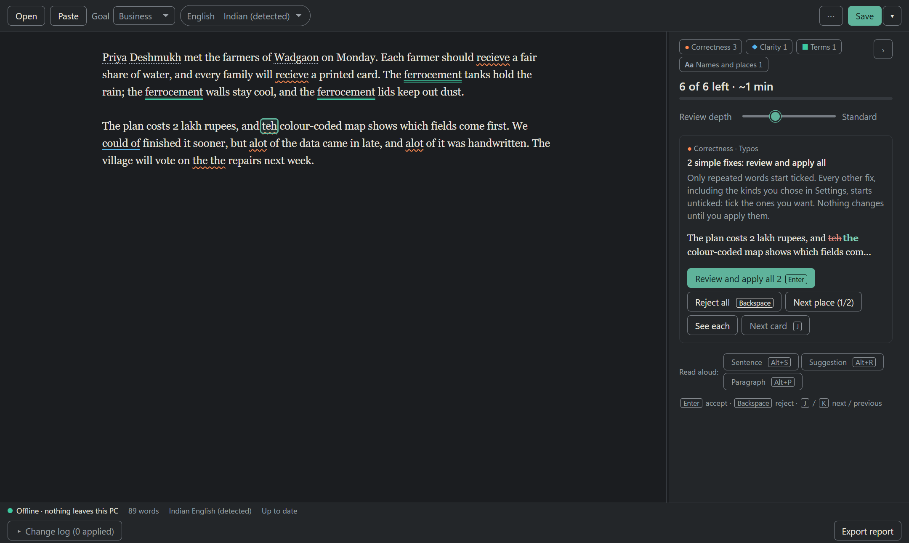

# Kashiro

[](https://github.com/skmaiti2050/kashiro/releases/latest)
[](LICENSE)


**[Download Kashiro](https://github.com/skmaiti2050/kashiro/releases/latest)** · [Try it in your browser](https://skmaiti2050.github.io/kashiro/) · [Report a wrong change](https://github.com/skmaiti2050/kashiro/issues/new?template=wrong-change.yml) · [Report a bug](https://github.com/skmaiti2050/kashiro/issues/new?template=bug.yml)



A free, offline proofreader for your writing. Its mark is a touchstone, the dark stone gold is tested on, with one gold streak. It runs entirely on your computer: no account, no upload, no internet connection.

Status: version 1.0, Windows. The app's interface is in English, Hindi and Bengali. Proofreading rules are English for now; Hindi rules are the next focus (see [Roadmap](#roadmap)).

## What it does

- Checks `.txt`, Markdown and Word (`.docx`) files for spelling, grammar, repeated words, a/an and punctuation, using the [Harper](https://github.com/Automattic/harper) grammar engine.
- **Never changes your text without asking.** Without a click, it only removes invisible characters and collapses extra spaces between words, and an independent check undoes even that if a word would change. Every other fix is a suggestion you accept.
- Simple fixes come on one card ("N simple fixes: review and apply all"). Only clear slips such as "the the" start ticked; everything else waits for you to tick it.
- Word files keep their formatting; fixes can be written as tracked changes.
- An optional AI helper runs a small local model on your computer (llama.cpp) for harder suggestions. It never applies anything by itself.

## Installing

See INSTALL.md, next to this file in the installed app (in the source code: [docs/INSTALL.md](docs/INSTALL.md)): per-user installers and portable zips, with or without the AI helper. None needs administrator rights or an internet connection.

## Building it

You need Windows 10 or 11, Node.js 24, and Rust (stable) with the Tauri 2 prerequisites.

```
npm ci
npm run dev                                    # the app in development mode
npm test                                       # unit, engine and DOM tests
npm run trust                                  # the trust suite: never-damage and recall gates
npm run fetch:llama -- --vc-runtime <folder>   # the pinned llama.cpp files and Visual C++ runtime (docs/UPGRADING.md)
npm run release                                # both per-user installers and both portable zips
```

`npm run check-file -- <in> <out>` runs one document through the engine from the command line, which is handy for reproducing a report.

## Contributing

Contributions are welcome, especially Hindi and Bengali proofreading rules, translations, and reports of any fix that changed text it shouldn't have. Start with [CONTRIBUTING.md](CONTRIBUTING.md). To translate the interface, see [docs/TRANSLATING.md](docs/TRANSLATING.md). To report a security problem, see [SECURITY.md](SECURITY.md).

The design and the build plan, including the reasoning behind each safety rule, are in [docs/superpowers/](docs/superpowers/).

## Roadmap

- Hindi proofreading rules, then Bengali.
- AutoRecover, on by default.
- Checking in a background worker for long documents.

## Licence

Apache-2.0. Third-party notices are in `resources/notices/` and in the app under About.
